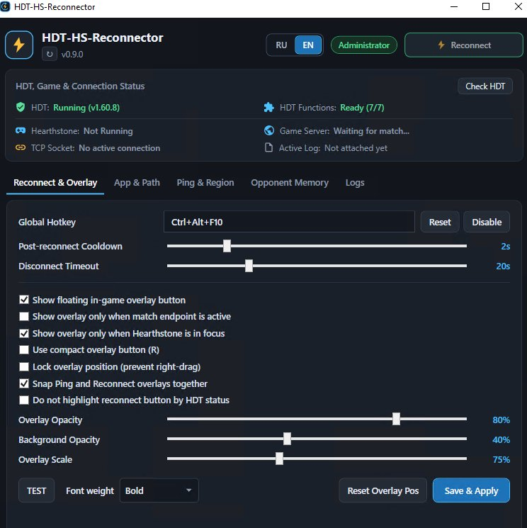
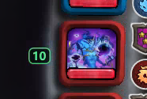
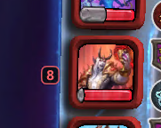
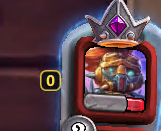
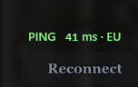

# HDT-HS-Reconnector

[**Русский**](README.ru.md) · [**Download for Windows x64**](https://github.com/testd1111/HDT-HS-Reconnector/releases/latest) · [**SHOW PING**](PING.md)

A standalone Windows app for reconnecting to your current Hearthstone match while preserving Hearthstone Deck Tracker Battlegrounds data.

> When Hearthstone Deck Tracker supported plugins, they had direct access to tracker match data (past opponent boards, tavern tiers, triples, etc.). Without plugin support, a regular reconnect loses this data in HDT.
>
> **Why this is a separate app from [HS-Reconnector](https://github.com/testd1111/HS-Reconnector):**
> - Preserving HDT data relies on companion DLLs (`HdtBootstrap.dll` and `HdtBridge.dll`) that hook into the HDT process.
> - Antivirus software may flag this approach, and some users prefer not to use process-hooking tools.
> - Future HDT updates may temporarily break data capture until HDT-HS-Reconnector is updated.
>
> If HDT hooks stop working after an update (or if HDT is not running), the app falls back to working as a regular reconnector. You can keep using standalone [HS-Reconnector](https://github.com/testd1111/HS-Reconnector) anytime.
>
> **P.S.** Also includes an optional last-combat result indicator (damage and win/loss/draw) on the leaderboard — configurable or can be disabled under **Opponent Memory**.

## Getting started

1. Download and extract the Windows x64 ZIP from [Releases](https://github.com/testd1111/HDT-HS-Reconnector/releases/latest), keeping **all three files in the same folder** (`HDT-HS-Reconnector.exe`, `HdtBootstrap.dll`, `HdtBridge.dll`).
2. Run `HDT-HS-Reconnector.exe` and approve the administrator prompt. Administrator access is required to reset the active game connection and connect to HDT.
3. During a match, press **Ctrl+Alt+F10** or click the overlay button to reconnect.

Requires Windows 10 (1803+) or Windows 11, x64 (and 64-bit HDT). The app detects Hearthstone and HDT automatically and lets you customize the global hotkey, overlay, and last-combat indicator.

**Compatibility with gaming accelerators.** HDT-HS-Reconnector may be unable to reconnect if a ping reducer or gaming accelerator redirects Hearthstone traffic through a proxy. HDT-HS-Reconnector needs to find the match-server TCP connection owned by Hearthstone. If reconnecting fails, try excluding Hearthstone from the accelerator or temporarily turning the accelerator off.

## Opponent Memory

In Solo Battlegrounds, a badge next to the previous opponent's portrait shows the last combat outcome and damage on the opposite side of HDT's tavern tier and tribe icons so nothing overlaps. It survives reconnects and can be customized (colors, damage number or dot, style, scale, offset) or disabled under **Opponent Memory**.

| Win — dealt 10 damage | Loss — took 8 damage | Draw — 0 damage |
| :---: | :---: | :---: |
|  |  |  |

## Ping & Region

The optional in-game overlay shows match-server latency and region. Enable it under **Ping & Region**. See [how it works and how to configure it](PING.md).

[Build and test instructions](BUILD_AND_INSTALL.md)

[MIT License](LICENSE)

## Download

 
