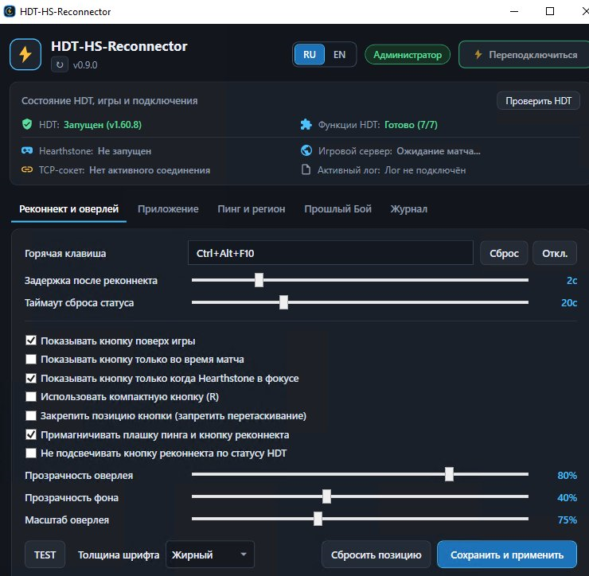
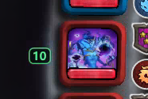
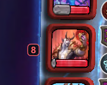
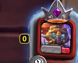
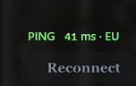

# HDT-HS-Reconnector

[**English**](README.md) · [**Скачать для Windows x64**](https://github.com/testd1111/HDT-HS-Reconnector/releases/latest) · [**SHOW PING**](PING.ru.md)

Отдельная программа для Windows, которая переподключает к текущему матчу Hearthstone и сохраняет данные Полей сражений в Hearthstone Deck Tracker.

> Раньше плагины для Hearthstone Deck Tracker имели прямой доступ к данным игры (прошлые столы противников, уровни таверны, триплеты и т. д.). Без поддержки плагинов при обычном реконнекте эти данные в HDT теряются.
>
> **Почему это отдельная программа, а не обновление [HS-Reconnector](https://github.com/testd1111/HS-Reconnector):**
> - Для сохранения данных HDT используются дополнительные DLL (`HdtBootstrap.dll` и `HdtBridge.dll`), которые перехватывают данные дектрекера.
> - Антивирусы могут реагировать на такой механизм, и не всем комфортно им пользоваться.
> - После обновлений HDT перехват может временно перестать работать до выхода обновления программы.
>
> Если после обновления HDT перехват перестанет работать (или HDT не запущен), программа просто продолжит работать как обычный реконнектор. При желании всегда можно пользоваться обычным [HS-Reconnector](https://github.com/testd1111/HS-Reconnector).
>
> **P.S.** Также добавлено отображение результата прошлого боя (урон и победа/поражение/ничья) на таблице лидеров — можно настроить или отключить на вкладке **Прошлый Бой**.

## Как пользоваться

1. Скачайте ZIP для Windows x64 из [раздела релизов](https://github.com/testd1111/HDT-HS-Reconnector/releases/latest) и распакуйте **все три файла в одну папку** (`HDT-HS-Reconnector.exe`, `HdtBootstrap.dll`, `HdtBridge.dll`).
2. Запустите `HDT-HS-Reconnector.exe` и подтвердите запрос прав администратора. Эти права нужны для сброса активного игрового соединения и подключения к HDT.
3. Во время матча нажмите **Ctrl+Alt+F10** или кнопку поверх игры, чтобы переподключиться.

Требуется Windows 10 (1803+) или Windows 11, x64 (и 64-битный HDT). Программа автоматически находит Hearthstone и HDT, позволяет настроить горячую клавишу, кнопку поверх игры и индикатор прошлого боя.

**Совместимость с игровыми ускорителями.** Переподключение может не сработать, если программа для снижения пинга или игровой ускоритель перенаправляет трафик Hearthstone через прокси. HDT-HS-Reconnector должен найти TCP-соединение с сервером матча, принадлежащее процессу Hearthstone. Если переподключение не срабатывает, попробуйте исключить Hearthstone из ускорителя или временно отключить ускоритель.

## Прошлый Бой

В Solo Полях сражений рядом с портретом предыдущего противника отображается метка с исходом и уроном прошлого боя — с обратной стороны от иконок уровня таверны и типа существ HDT, чтобы элементы не накладывались друг на друга. Метка сохраняется после реконнекта, а цвета, режим (цифра или точка), стиль, размер и смещение настраиваются на вкладке **Прошлый Бой** (там же функцию можно отключить).

| Победа — нанесли 10 урона | Поражение — получили 8 урона | Ничья — 0 урона |
| :---: | :---: | :---: |
|  |  |  |

## Пинг и регион

Дополнительная плашка показывает задержку до сервера матча и регион. Её можно включить на вкладке **Пинг и регион**. Подробнее о [работе и настройке плашки](PING.ru.md).

[Инструкция по сборке и проверкам на английском](BUILD_AND_INSTALL.md)

[Лицензия MIT](LICENSE)
